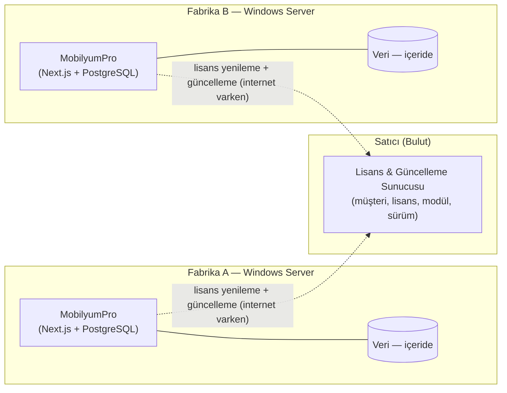

# ARCHITECTURE — Mimari (Taslak)

> ⚠️ **Durum: PLANLAMA / TASLAK.** Buradaki seçimler henüz kesinleşmedi.
> Kesinleşen kararlar `../MEMORY.md` ve `DECISIONS.md`'ye işlenir.

## 1. Hedef ve Kısıtlar
Mobilya fabrikası iş süreçlerini (stok, üretim, cari, satış) tek bir web
uygulamasında yönetmek. Ürün birçok fabrikaya satılacak; ancak hedef sektör
verisinin fabrika dışında tutulmasını istemediği için **saf on-premise**
tasarlanır: her fabrikanın **kendi sunucusunda**, **internetsiz** çalışır.
Her kurulum tek bir fabrikaya aittir (single-tenant).

## 2. Teknoloji Yığını (Karar)

| Katman | Seçim | Not |
|---|---|---|
| Frontend | **Next.js (App Router) + TypeScript** | SSR/RSC, modüler yapı |
| UI | **shadcn/ui + Tailwind CSS** | Erişilebilir, tema desteği |
| Form & Doğrulama | React Hook Form + **Zod** | Tip güvenli formlar |
| Veri çekme | Server Actions / TanStack Query | Duruma göre |
| Veritabanı | **PostgreSQL** | On-premise, ücretsiz, hızlı kurulum |
| ORM | **Prisma** | Soyutlama; ileride SQL Server kapısı açık |
| Auth | **NextAuth / Auth.js** | Local kimlik doğrulama, offline çalışır |
| Çalışma ortamı | **Self-hosted Node** (fabrika sunucusu) | Vercel YOK |
| Paketleme/kurulum | Docker veya Windows installer (🔴 açık) | Bkz. ADR-0005 |

## 3. On-premise Stratejisi (Kritik)
- Uygulama + PostgreSQL fabrikanın sunucusunda çalışır; dış servise bağımlı değil.
- Veri erişimi **Prisma** arkasına alınır → ileride SQL Server isteyen müşteri
  için kapı açık kalır. DB'ye özgü kestirmelerden kaçınılır.
- Auth tamamen local (NextAuth + DB). Bulut auth servisine bağımlılık YOK.
- **Operasyonel zorluklar** (on-premise satışın bedeli): çok sahaya kurulum,
  sürüm güncellemesi dağıtımı, lisanslama/aktivasyon, müşteri verisi yedekleme.
  Bunlar baştan planlanmalı (ADR-0005).

> 🔑 Hedef fabrika sunucu profili (Windows Server / normal PC?) netleşmeli;
> paketleme kararı (Docker vs installer) buna bağlı.

## 3.1 Sistem Topolojisi (İki Bileşen)

İki ayrı yazılım var:

1. **MobilyumPro (on-premise app)** — fabrikada Windows Server'da çalışır. Müşteri
   verisi burada, içeride, offline çalışır. Modüller lisansa göre açılır.
2. **Merkezi Lisans & Güncelleme Sunucusu** — satıcıda/bulutta. Müşteri, lisans,
   modül yetkilendirme ve sürüm dağıtımı. **Müşteri iş verisini tutmaz.**



**Kritik kural:** Noktalı bağlantılar (internet) kopsa bile fabrikalar çalışır.
Lisans imzalı ve offline-grace'lidir; merkezi sunucu yalnızca yenileme ve
güncelleme için gerekir, günlük operasyon için değil.

## 4. Önerilen Klasör/Modül Yapısı (Taslak)
```
app/
  (auth)/            # giriş, oturum
  (dashboard)/
    stok/
    uretim/
    cari/
    satis/
  api/
modules/             # iş mantığı (domain) — UI'dan bağımsız
  inventory/
  production/
  contacts/
  sales/
lib/                 # db, auth, utils
components/ui/       # shadcn bileşenleri
prisma/              # şema & migration
docs/
```

## 5. Yatay (cross-cutting) Konular
- **Yetkilendirme (RBAC):** rol bazlı erişim — modül ve aksiyon düzeyinde.
- **Denetim izi (audit log):** kim, ne zaman, ne değiştirdi.
- **Tenant (KARAR):** Her kurulum single-tenant (tek fabrika). RLS gerekmez. Yine de `company_id` korunur; bir fabrikanın birden çok şubesi/legal şirketi olabilir.
- **Raporlama:** stok durumu, üretim takibi, cari ekstre, satış analizleri.
- **Yedekleme & veri göçü:** özellikle on-premise senaryoda.

## 6. Açık Mimari Soruları
Bkz. `../MEMORY.md` → "Açık Sorular". Özellikle dağıtım modeli ve multi-tenant
kararı tüm mimariyi etkiler.
