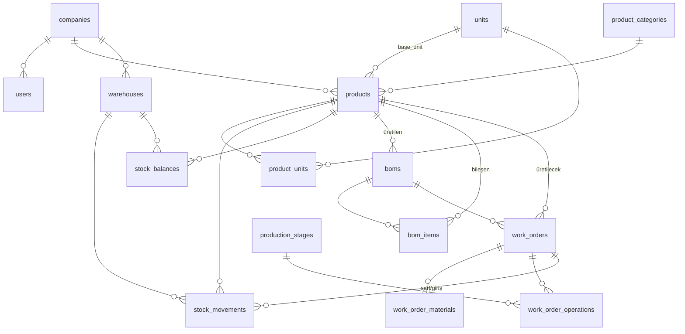

# DATA MODEL — Veri Modeli Taslağı (MVP: Stok + Üretim)

> ⚠️ **Durum: PLANLAMA / TASLAK.** Bu bir tartışma taslağıdır — henüz kod/şema değil.
> Amaç: "hangi tablolar var, hangi ana alanlar, nasıl ilişkili" sorusunu netleştirmek.
> Onaylanınca Prisma şemasına dönüştürülecek.
>
> **MVP kapsamı:** Çekirdek + **Stok** + **Üretim**. Cari/Satış sonraki fazlar
> (bu dokümanda "ileride" diye işaretli). Model baştan **e-Fatura'ya hazır**.

## Genel Prensipler
- Her tablo bir `company_id` taşır (bir fabrikanın **çok şubesi/şirketi** olabilir; her kurulum tek müşteriye ait — single-tenant).
- Ortak alanlar: `id`, `company_id`, `created_at`, `updated_at`, `created_by`, `is_active`.
- Önemli tablolarda **denetim izi** (audit log) tutulur.
- Parasal alanlar `decimal` + para birimi; miktarlar `decimal` (kesirli birimler için: m², m³).
- Stok bakiyesi hareketlerden hesaplanır; performans için `stock_balances` özet tablosu tutulur.

---

## 1. Çekirdek (Core)

### companies (şirket/şube)
Firma/şube bilgileri. **e-Fatura için kritik alanlar burada.**
- `id`, `name`, `is_active`
- `tax_number` (VKN/TCKN), `tax_office` (vergi dairesi)  ← e-Fatura
- `address`, `city`, `district`, `country`, `postal_code`  ← e-Fatura
- `phone`, `email`
- `parent_company_id` (çok şubeli yapı için, nullable)

### users
- `id`, `company_id`, `full_name`, `email`/`username`, `password_hash`
- `is_active`, `last_login_at`
- Auth: NextAuth/Auth.js (local).

### roles & permissions (RBAC)
- `roles`: `id`, `company_id`, `name` (ör. Yönetici, Depo, Üretim, Satış, Muhasebe)
- `permissions`: `id`, `code` (ör. `stock.read`, `stock.write`, `production.manage`)
- `role_permissions`: `role_id`, `permission_id`
- `user_roles`: `user_id`, `role_id`

### app_settings / license (lisans & modül durumu)
- Aktif modüller, lisans bilgisi (merkezi sunucudan gelen imzalı token burada cache'lenir).
- `enabled_modules`, `license_expires_at`, `license_token`.

### audit_log
- `id`, `company_id`, `user_id`, `entity`, `entity_id`, `action`, `changes` (json), `created_at`

---

## 2. Stok (Inventory)

### product_categories (ürün kategorileri)
- `id`, `company_id`, `name`, `parent_id` (ağaç yapı)

### units (birimler)
- `id`, `company_id`, `name` (Adet, m², m³, Metretül, Kg, Plaka, Paket)
- `efatura_code` (e-Fatura UBL birim kodu: C62=adet, MTK=m², MTR=metre, KGM=kg...) ← e-Fatura

### products (ürün/malzeme kartı)
Hammadde, yarı mamul ve mamulü kapsar.
- `id`, `company_id`, `code` (stok kodu), `name`, `barcode`
- `type` — enum: `raw` (hammadde), `semi` (yarı mamul), `finished` (mamul)
- `category_id`, `base_unit_id`
- `min_stock`, `critical_stock` (uyarı için)
- `tax_rate` (KDV %)  ← e-Fatura
- `gtip_code` (opsiyonel)  ← e-Fatura
- `is_active`
- **Mobilya notu:** plaka/m² gibi dönüşümler için aşağıdaki `product_units`.

### product_units (birim dönüşümleri)
Örn. 1 Plaka = 2.44 × 1.83 m² gibi alternatif birimler.
- `id`, `product_id`, `unit_id`, `factor` (base birime çarpan)

### warehouses (depolar)
- `id`, `company_id`, `name`, `code`, `is_active`
- (ops.) `locations` — raf/lokasyon: `id`, `warehouse_id`, `code`

### stock_movements (stok hareketleri) — ⭐ merkez tablo
Tüm giriş/çıkış buradan akar.
- `id`, `company_id`, `product_id`, `warehouse_id`
- `movement_type` — enum: `in` (giriş), `out` (çıkış), `transfer`, `count` (sayım),
  `production_issue` (üretim sarfı), `production_receipt` (üretim girişi)
- `quantity`, `unit_id`
- `unit_cost`, `total_cost` (maliyet takibi)
- `reference_type`, `reference_id` (ör. work_order, satın alma, irsaliye — ileride)
- `movement_date`, `created_by`, `note`

### stock_balances (özet bakiye — performans)
- `product_id`, `warehouse_id`, `quantity` (hareketlerden güncellenir)

> **İleride (Cari/Satın alma):** `suppliers` cari modülüyle gelir; stok girişleri satın alma irsaliyesine bağlanır.

---

## 3. Üretim (Production)

### boms (ürün ağacı / reçete — başlık)
Bir mamul/yarı mamulün nasıl üretildiği.
- `id`, `company_id`, `product_id` (üretilen ürün), `name`, `version`, `is_active`

### bom_items (reçete kalemleri)
- `id`, `bom_id`, `component_product_id` (kullanılan malzeme)
- `quantity`, `unit_id`
- `waste_percent` (fire/zayiat %)  ← mobilyada önemli (kesim firesi vb.)

### production_stages (üretim aşamaları/istasyonlar)
Mobilya tipik akış: Kesim → Bantlama → Delik/CNC → Montaj → Boya → Paketleme.
- `id`, `company_id`, `name`, `sequence`

### work_orders (iş emirleri) — ⭐
- `id`, `company_id`, `code`, `product_id` (üretilecek), `bom_id`
- `quantity`, `unit_id`
- `target_warehouse_id` (üretim sonrası giriş deposu)
- `status` — enum: `planned`, `released`, `in_progress`, `completed`, `cancelled`
- `planned_start`, `planned_end`, `actual_start`, `actual_end`
- `created_by`
- `sales_order_id` (nullable — ileride Satış modülü; siparişe göre üretim için)

### work_order_materials (iş emri malzeme planı/sarfı)
Planlanan vs. fiili sarf.
- `id`, `work_order_id`, `component_product_id`
- `planned_quantity`, `actual_quantity`, `unit_id`
- (fiili sarf → `stock_movements` type=`production_issue`)

### work_order_operations (iş emri operasyonları/aşama takibi)
- `id`, `work_order_id`, `stage_id`, `sequence`
- `status`, `start_at`, `end_at`, `assigned_to`

> **Maliyet:** İş emri tamamlanınca malzeme maliyeti (sarf × birim maliyet) +
> (ileride) işçilik/genel gider → mamul maliyeti. MVP'de malzeme maliyeti yeterli.

---

## 4. İlişki Diyagramı (ER — MVP)

---

## 5. Açık Noktalar (tartışılacak)
1. **Birim/dönüşüm:** Mobilyada m²/plaka/metretül dönüşümleri nasıl çalışsın? Otomatik mi, kullanıcı mı girsin?
2. **Fire/zayiat:** Reçetede sabit % mi, yoksa kesim optimizasyonuna göre değişken mi?
3. **Aşama takibi:** İş emri sadece "tamamlandı" mı, yoksa istasyon istasyon (kesim/bantlama/montaj) ilerleme takibi mi gerekiyor?
4. **Parti/seri:** Lot veya seri no takibi gerekiyor mu (ör. boya partisi)?
5. **Maliyet:** MVP'de işçilik/genel gider maliyeti dahil mi, sadece malzeme mi?
6. **Barkod:** Depoda barkdla giriş/çıkış MVP'de var mı?
