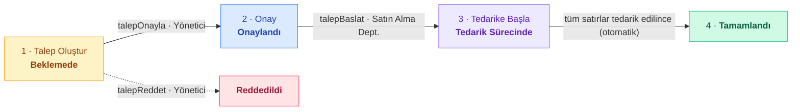
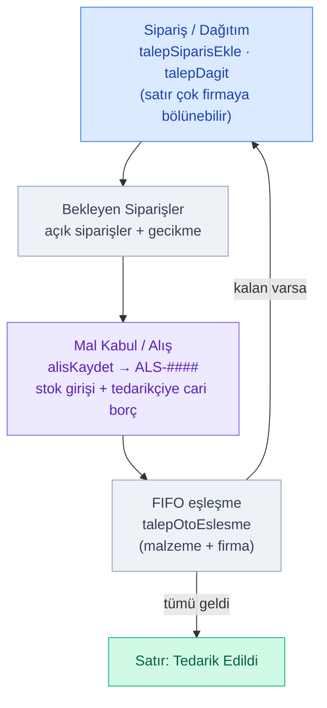
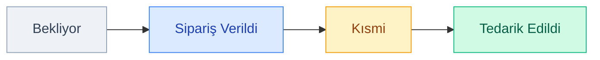

# Satın Alma Modülü — Aşamalar

Üretim planındaki eksik malzemeden başlayıp mal kabulle stoğa girişe kadar
uzanan yaşam döngüsü. Talep onaydan tedarik sürecine, oradan firmalara sipariş
ve faturayla eşleşen mal kabule ilerler.

> Bu belgenin zengin, açık/koyu temalı görsel sürümü: [`satin-alma-akis.html`](./satin-alma-akis.html)
> (tarayıcıda açın).

İlgili ekranlar: **Satın Alma Talepleri** · **Bekleyen Siparişler** ·
**Satın Alma Şartları** · **Satın Alma (Alış)**.

---

## 1) Talep Yaşam Döngüsü

| # | Aşama | Durum | Tetik | Kim | Not |
|---|-------|-------|-------|-----|-----|
| 1 | Talep Oluştur | `Beklemede` | `talepOlustur` | Planlama / Kullanıcı | Üretim planındaki eksik malzeme (ya da elle) talebe dönüşür. Stoku etkilemez. |
| 2 | Onay | `Onaylandı` | `talepOnayla` | **Yönetici** | Audit'e onaylayan + tarih düşer. |
| 2b | Red | `Reddedildi` | `talepReddet` | **Yönetici** | Red nedeni yazılır. **Bitiş durumu** — tedarik başlamaz. |
| 3 | Tedarike Başla | `Tedarik Sürecinde` | `talepBaslat` | **Satın Alma Dept.** | Artık firmalara sipariş ve mal kabul yapılabilir. |
| 4 | Tamamlandı | `Tamamlandı` | mal kabul eşleşmesi (otomatik) | Sistem | Tüm satırlar tam tedarik edilince kapanır; son alış fişi talebe bağlanır. |

---

## 2) "Tedarik Sürecinde" — Operasyon Döngüsü

Talep tedarik sürecindeyken, her satır için sipariş ve mal kabul adımları
kalan bitene kadar tekrar eder.

- **Sipariş / Dağıtım** (`talepSiparisEkle`, `talepDagit`): talep satırı bir ya da
  **birden çok firmaya** bölünerek sipariş edilir. Firma seçilince **Satın Alma
  Şartları**'ndan fiyat, döviz ve tedarik süresi önerilir. Verilen sipariş
  **Bekleyen Siparişler** ekranında toplanır.
- **Mal Kabul** (`alisKaydet`): alış fişi (`ALS-####`) kesilir — tek transaction'da
  **stok girişi** (Giriş hareketi) + **tedarikçiye cari borç** (Alacak). `talepOtoEslesme`
  **FIFO** ile açık siparişlere otomatik eşleşir; satır kısmen ya da tam kapanır.

### Satır durumu — bir talep kaleminin ilerleyişi

---

## 3) Bağlı Kayıtlar & Ekranlar

| Ekran / Kayıt | Rolü | Anahtar alanlar |
|---------------|------|-----------------|
| **Satın Alma Şartları** (`SatinAlmaSarti`) | Firma × malzeme anlaşması; sipariş ve mal kabulde fiyat + tahmini teslimi besler. | Fiyat · Döviz · Tedarik süresi · Min. sipariş |
| **Bekleyen Siparişler** (`BekleyenSiparis`) | Sipariş verilmiş ama tam tedarik edilmemiş kalemlerin talepler-arası birleşik görünümü. | Kalan miktar · Tahmini teslim · Gecikti |
| **Satın Alma (Alış)** (`Alis`) | Her mal kabulün ürettiği fiş; stok hareketi + tedarikçi cari Alacak. | Stok girişi · Cari borç · `ALS-####` |

## Roller

- **Yönetici** — onay / red (`talepOnayla`, `talepReddet`)
- **Satın Alma Departmanı** — başlat · sipariş / dağıtım · mal kabul (`talepBaslat`, `talepSiparisEkle`, `talepDagit`, `alisKaydet`)
- **Otomatik (sistem)** — FIFO eşleşme · tamamlanma (`talepOtoEslesme`)

> Roller şimdilik stub kullanıcıdan çözülüyor; oturum altyapısı gelince gerçek
> giriş yapan kullanıcıya bağlanacak. Durum renkleri uygulamadaki rozetlerle birebir.

---

## İlgili kod

- Tipler: [`src/lib/data.ts`](../src/lib/data.ts) — `TalepDurum`, `TalepSatirDurum`, `SatinAlmaTalep`, `TalepSiparis`, `BekleyenSiparis`, `SatinAlmaSarti`
- Aksiyonlar: [`src/lib/db/actions.ts`](../src/lib/db/actions.ts) — `talepOlustur`, `talepOnayla`, `talepReddet`, `talepBaslat`, `talepSiparisEkle`, `talepDagit`, `alisKaydet`, `talepOtoEslesme`
- Ekranlar: `src/app/(panel)/satin-alma/…` (`talepler`, `siparisler`, `sartlar`, `yeni`)
